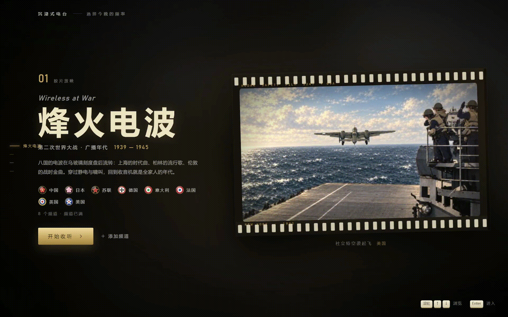
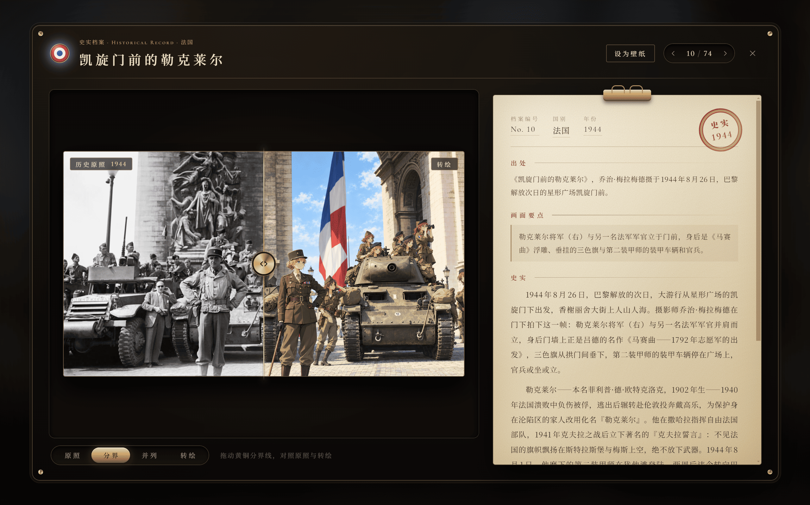
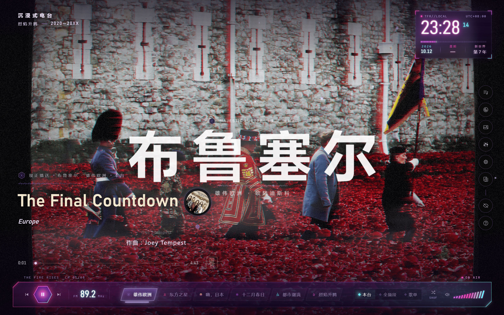
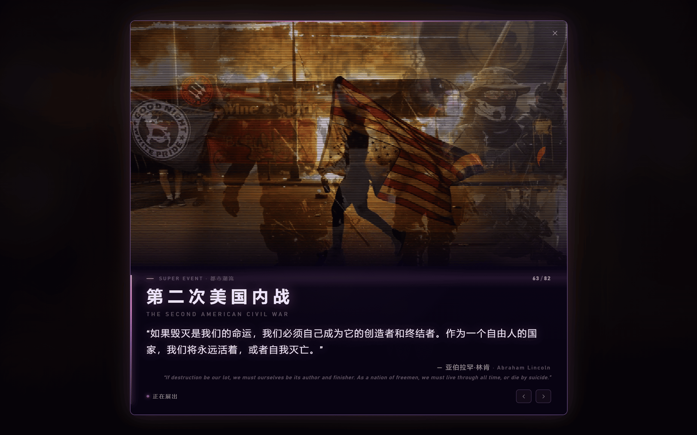
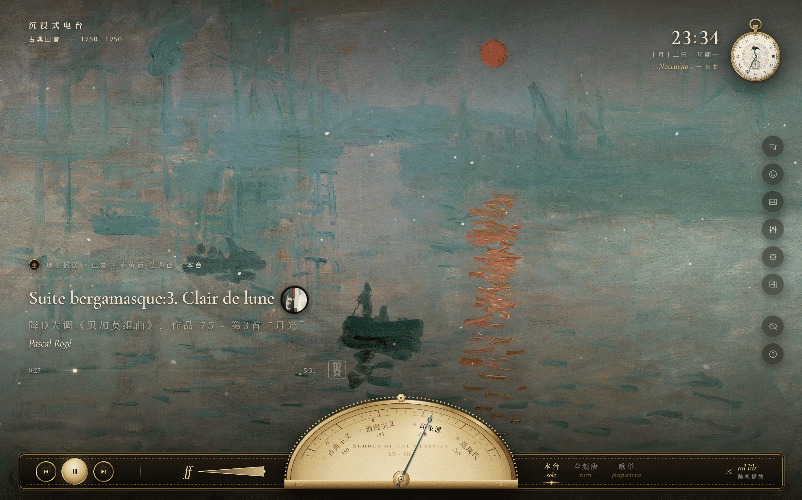
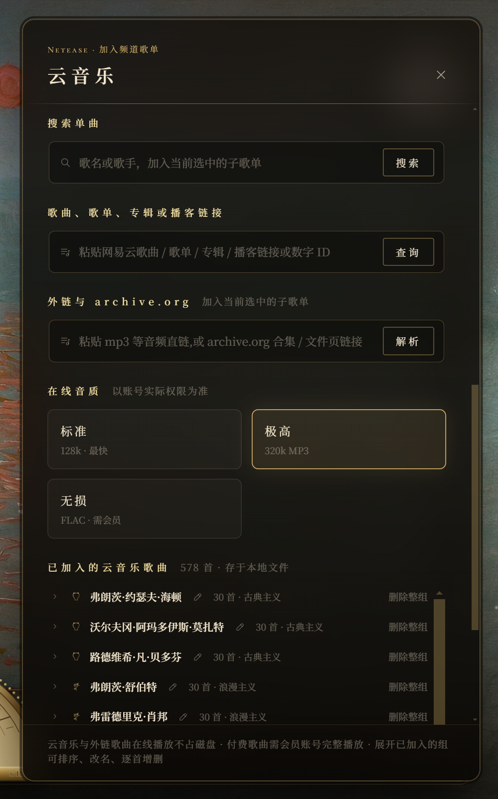
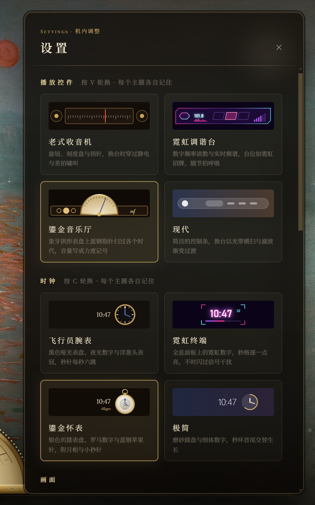
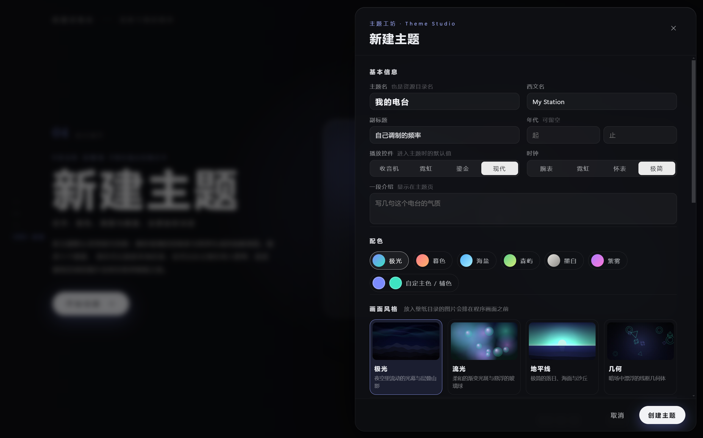

# 沉浸式电台

可在浏览器运行的沉浸式音乐电台。想听钢丝的歌单和 The Fire Rises（TFR）模组里的电台，又不想一直开着游戏，所以搓了。目前内置三个主题，每个主题有自己的频道、壁纸与界面风格：烽火电波回到第二次世界大战的广播年代，八个主要势力国家各有一座电台；烈焰升腾取材自钢丝的现代架空模组 TFR，六座电台来自模组的原声音轨和音乐扩展；古典回音从古典主义播到二十世纪，同时欣赏名画原作。

沉浸式的屏幕体验：立体壁纸可随鼠标移动变换视角，鼠标停下后界面自己隐去，只留歌名与时钟；也可最小化到后台只听声音，标签页标题会实时显示正在播放的曲目，不占性能。歌曲可以扫码登录网易云音乐加进电台在线收听，也可以自行添加音频与壁纸。

**在线体验**：[radio.rheinx.top](https://radio.rheinx.top)



## 三个主题

### 烽火电波


回到收音机就是全家人的年代。中波 600—1300 kHz 上排着八座电台：上海的时代曲、东京的歌谣曲、莫斯科的苏联歌曲、柏林的流行歌曲与军乐、罗马的意大利歌曲、巴黎的香颂、伦敦的战时金曲、纽约的摇摆乐。转动刻度盘锁定一座电台时，当年真实的开场语会浮现出来——「这里是上海」「Говорит Москва」「Hier ist Berlin」「This is London」。

壁纸以史实照片为底本重新绘制，按国家分为八个组共一百余幅。在画廊里掀开壁纸的折角，可以在历史原照与重绘画面之间连续变形地对照；档案卡写明这张照片是谁在何时何地拍下的、画面里正在发生什么，以及围绕它的三段史实。目前登记在册的史实照片有 74 张，每一张都能翻阅。



### 烈焰升腾



取材自《钢铁雄心 4》的知名现代架空模组 The Fire Rises。模组从 2020 年 1 月 1 日开局：美国与伊朗剑拔弩张，一种陌生的新型病毒正在蔓延，油价震荡、社会撕裂——一个与我们相距不远的世界，正一步一步滑向另一条时间线。主题的视觉取自这个世界：紫色调的赛博朋克，霓虹、扫描线、雨夜与燃烧的天际线。

调频段上六座电台来自模组的音乐扩展，各自播着模组世界里的流行乐：雄伟欧洲放欧罗巴花园里的热门与遗珠，东方之星放"穿过长城运来的歌"，嗨日本放加班族的城市流行，十二月春日放俄语摇滚与流行，都市潮流放给爱赶时髦的人，烈焰升腾本台放模组原声与世界各处搜罗来的氛围音乐。

壁纸是模组的超级事件插画与加载屏，共一百余幅，其中 82 张登记在册。双击一幅插画，可以查看它对应的事件全文与引语——每一张都是这个世界走向岔路的时刻。



### 古典回音



从维也纳古典乐派到二十世纪，四个时期四座电台：古典主义在海顿、莫扎特与贝多芬的维也纳播交响曲与奏鸣曲；浪漫主义在莱比锡播舒伯特、肖邦与勃拉姆斯的艺术歌曲与钢琴诗；印象派在巴黎播德彪西、拉威尔与萨蒂；近现代在纽约播斯特拉文斯基、肖斯塔科维奇与格什温。四座台分列长波段，锁定电台时浮现的呼号用了与各时期气质相符的演奏术语——Allegro con brio、Con fuoco、Doux et rêveur、Molto ritmico。

壁纸是各时期的名画原作，共 32 幅：从韦尔内的《海难》、德拉克洛瓦的《自由引导人民》、艾伊瓦佐夫斯基的《九级浪》，到莫奈的《印象·日出》、梵高《罗纳河上的星月夜》，再到毕加索的《格尔尼卡》与霍普的《夜游者》。界面配鎏金音乐厅控件与怀表时钟，掀开折角能读到每幅画的出处与鉴赏。指针停在哪里，音乐厅的灯就为哪个时代亮起。

## 功能一览

**立体壁纸** — 每张壁纸都预先算出深度图，画面是一个真正的立体场景：鼠标移动时前景遮挡背景，人物身后能飘过雪与火星；滚轮可以把画面上下推移，看清楚天空或地面；鼠标停下数秒后，视角会自己缓慢漂移，画面始终是活的。每张壁纸配有专属的粒子氛围——敦刻尔克的海滩有盐雾，斯大林格勒的废墟有火星，罗马的春天有花瓣——粒子颜色会自动向画面色调靠拢，不必逐张调色。切换壁纸时远景先浮现、人物最后到场；亮处会洒出体积光，泛光随节拍呼吸。

**一台真的收音机** — 换台是一段过程：指针扫过刻度盘，离开原台时信号迅速衰减、被静电淹没，途经其他电台时差拍啸叫掠过，锁定新台时啸叫滑向零拍消失。这些不是录好的音效，而是由滤波器、噪声源与振荡器在 Web Audio 上实时演奏的。信号越弱，音乐的频带越窄、静电越响；调到停用的频道，只剩静电与远方断续的电码。收听方式有三种：只听本台、全部启用的频道随机混播（像收听全频段）、播放自选歌单。

**歌单** — 歌单面板里每座电台的歌曲按分组陈列，可以整组开关，不想听的单曲点一下就跳过；任何一首都能点播，或收进珍藏与自建歌单，歌单里拖动即可调整顺序。播放顺序支持顺序、随机与单曲循环。

**网易云音乐** — 扫码登录后，把网易云音乐里的单曲、任意歌单、专辑、播客单期或整座播客电台加进电台的分组歌单：可以并入现有分组（自动按歌曲去重），也可以新建分组。音频不下载到本地，播放时在线取流，有歌词的歌会在播放卡片上随进度逐句浮现。已加入的分组可以展开管理：拖动排序、双击改名（改成已有名字即合并）、逐首增删。歌单库可以导出备份、换设备导入。

**外链音频** — 同一个面板也接受 archive.org 的合集或文件页链接（合集会列出全部音频供勾选）与任意音频文件的链接，加入的歌单与网易云音乐歌曲一视同仁。

**白噪音混音器** — 雨声、风声、林间、篝火、战壕炮火、远方炮声六种文件音源，另有雪夜、电台杂音、座钟三种由 Web Audio 实时合成；每种音量独立可调，叠在音乐之下。放入自己的音频文件（同名）即可替换对应种类，缺少的种类由程序合成补位。

**控件与时钟** — 播放控件四种：老式收音机、霓虹调谐台、鎏金音乐厅、现代控制条；时钟四种：飞行员腕表、霓虹终端、鎏金怀表、极简圆盘。每个主题有自己的默认搭配，选择各自记住，随时轮换。

| 网易云音乐面板 | 设置面板 |
|:---:|:---:|
|  |  |

**自建电台** — 内置主题编辑器，可以从零搭一座电台：频道、刻度盘、配色、纹样、壁纸分组全在界面上搭配；内置主题也能追加自己的频道。



**键盘操作** — 常用操作都有快捷键：空格播放暂停，左右方向键切歌，方括号换台，Q、W 换壁纸，1、2、3 切换收听方式，V、C 轮换控件与时钟，L、N、G、E、O 打开歌单、网易云音乐、画廊、混音器与设置，H 隐藏整个界面，按 `?` 查看全部。

**为长时间挂着设计** — 鼠标静止片刻控件隐去，只剩歌名与时钟；标签页标题实时显示正在播放的曲目，后台听歌时瞄一眼就知道在放什么；键盘上的媒体键与系统音量浮层同样接管了控制；界面静止时还会自动降低渲染帧率，省下显卡。

## 快速开始

需要较新的 Node.js：

```bash
cd 前端
npm install
npm run dev     # 打开 http://127.0.0.1:5173；同一网络里的手机、平板访问终端打印的局域网地址（Network 一行）也能用
```

打开后先按开机键——浏览器要求一次交互才允许出声，这一下正好由开机承担。

**不用准备音频**：按 N 打开网易云音乐面板，扫码登录后把网易云音乐里的歌加进各台的分组歌单，即可在线收听。

**壁纸与音效自备**：图片与音频不入库。壁纸图放进 `Resources/` 下对应主题的壁纸目录（如 `Resources/WWII Wallpapers/GER/`）、环境声音效放进 `Resources/White Noise/`，刷新页面就会出现在画廊与混音器里；深度图与缩略图由开发服务器在后台自动生成（需要 Python，缺少时照常显示，只是画面少了立体感）。仓库里保留着每张壁纸的登记信息与配色数据（`史实照片.json`、`超级事件.json`、`paintings.json` 与 `前端/public/gen/` 下的元数据），自备图片的文件名与登记一致即可自动配对。

目录结构、扩展方法与线上部署详见 [前端/README.md](前端/README.md)。

## 免责声明

本项目为个人兴趣驱动的自用项目，无任何商业目的。项目以第二次世界大战时期的广播文化为主题，涉及的歌曲、照片与文字均属历史资料，收录仅出于历史记录、收藏与回望的目的。

- 本项目不代表、不支持任何政治立场、意识形态或战争行为。界面上出现的国家、旗帜、徽记与纹样均为特定历史时期的视觉符号，只为还原年代氛围，不含任何宣扬与认同之意。
- 史实照片的版权归属原拍摄者与收藏机构（出处已在各档案中逐一注明），本项目的壁纸是以个人收藏与学习为目的、基于历史影像的美术再创作；若相关权利方提出异议，将即时撤下对应内容。
- 收录的音频仅限个人欣赏与本项目展示，不用于公开传播或商业用途；请勿将本项目内容用于任何宣扬极端思想的场合。
